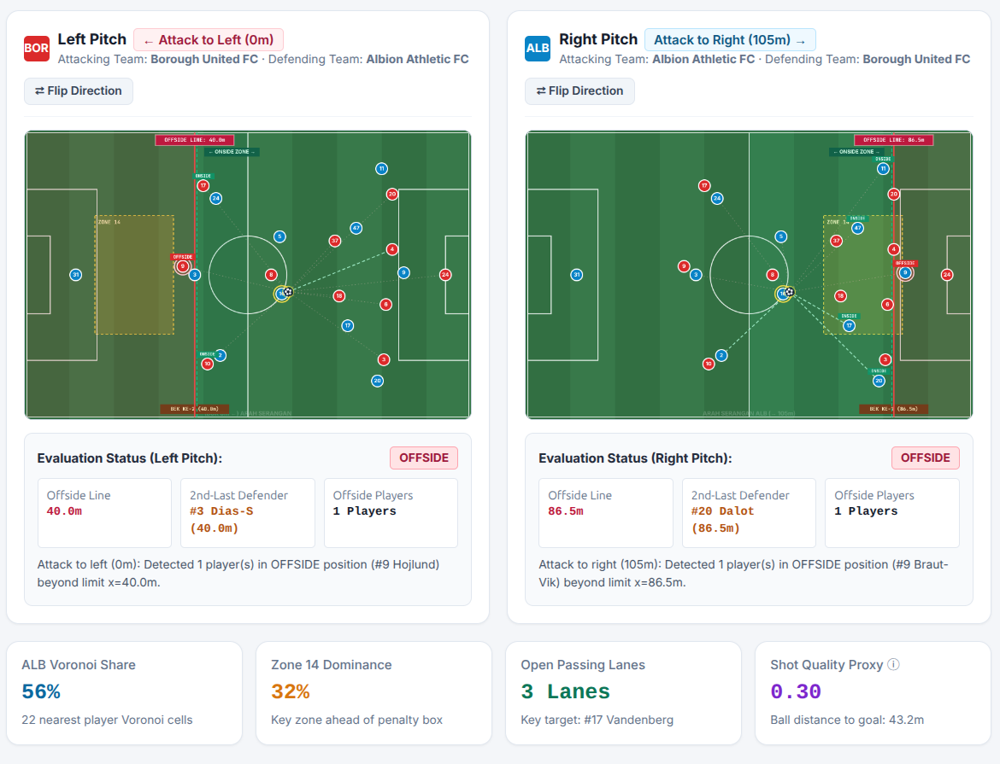
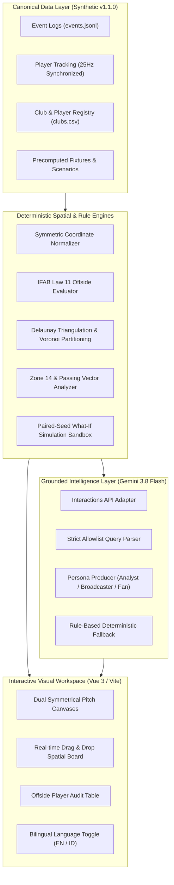

# Alcyone AI

<p align="center">
  <strong>Grounded AI Football Tactical Intelligence, Symmetrical Spatial Pitch Engine & What-If Sandbox</strong>
</p>

<p align="center">
  
  
  
  
  
  
  
  
  
  
</p>

---

<p align="center">
  
</p>

> **Figure 1:** *Alcyone AI Symmetrical Dual-Pitch Board. Left pitch evaluates Borough United FC attacking left ($x=0\text{m}$), while Right pitch evaluates Albion Athletic FC attacking right ($x=105\text{m}$). Interactive voronoi space partitioning, Zone 14 key attacking pocket, 2nd-last defender tracking, and strict IFAB Law 11 offside boundary lines with real-time player status audit.*

---

## Table of Contents

- [1. Executive Summary](#1-executive-summary)
- [2. System Architecture & Core Philosophy](#2-system-architecture--core-philosophy)
- [3. Key Platform Capabilities](#3-key-platform-capabilities)
  - [Symmetric 2D Dual-Pitch Spatial Board](#symmetric-2d-dual-pitch-spatial-board)
  - [Deterministic IFAB Law 11 Offside Engine](#deterministic-ifab-law-11-offside-engine)
  - [Voronoi Spatial Tessellation & Pitch Control](#voronoi-spatial-tessellation--pitch-control)
  - [Zone 14 Dominance & Passing Vector Network](#zone-14-dominance--passing-vector-network)
  - [Paired-Seed What-If Tactical Simulation Sandbox](#paired-seed-what-if-tactical-simulation-sandbox)
  - [Multi-Persona Grounded AI Narrative (Gemini 3.8 Flash)](#multi-persona-grounded-ai-narrative-gemini-38-flash)
  - [Deterministic Natural Language Event Query](#deterministic-natural-language-event-query)
  - [Bilingual Internationalization (EN / ID)](#bilingual-internationalization-en--id)
- [4. Synthetic Dataset Specifications](#4-synthetic-dataset-specifications)
- [5. Mathematical & Algorithmic Formulations](#5-mathematical--algorithmic-formulations)
- [6. Project Structure](#6-project-structure)
- [7. Getting Started](#7-getting-started)
  - [Prerequisites](#prerequisites)
  - [Backend Setup (FastAPI)](#backend-setup-fastapi)
  - [Frontend Setup (Vue 3 / Vite)](#frontend-setup-vue-3--vite)
  - [Standalone Mode (Zero Build)](#standalone-mode-zero-build)
- [8. REST API Documentation](#8-rest-api-documentation)
- [9. Configuration & Environment Variables](#9-configuration--environment-variables)
- [10. Limitations & Boundaries](#10-limitations--boundaries)
- [11. License & Citation](#11-license--citation)

---

## 1. Executive Summary

**Alcyone AI** is an advanced football analytics, spatial modeling, and simulation platform designed for tactical analysts, coaches, sports data scientists, and creators.

Traditional sports analytics LLM tools suffer from severe domain hallucinations—fabricating player coordinates, inventing fictional event IDs, and producing statistically impossible offside evaluations. Alcyone AI solves this fundamentally by adopting an uncompromising architectural standard: **Compute facts deterministically; synthesize insights through grounded AI.**

All spatial metrics, Voronoi control zones, IFAB offside margins, and What-If counterfactual scenarios are computed mathematically via robust Python and JavaScript deterministic engines. Large Language Models (powered by **Google Gemini 3.8 Flash**) act strictly as narrative producers, translating verifiable mathematical outputs into grounded insights for Analysts, Broadcasters, and Fans without altering the underlying ground truth.

---

## 2. System Architecture & Core Philosophy

Alcyone AI separates data storage, deterministic computation, and AI narration into clean, isolated layers:



### Architectural Guarantees:
1. **Zero Hallucination Tolerance:** The AI model is strictly prohibited from inventing event IDs, shifting player coordinates, or calculating official match outcomes from freeform text.
2. **Symmetrical Consistency:** The offside decision for an identical tactical snapshot is mathematically identical whether attacking toward the left goal ($x=0\text{m}$) or the right goal ($x=105\text{m}$).
3. **Data Traceability:** Every metric links directly to source event logs, tracking coordinates, and explicit calculation methods.

---

## 3. Key Platform Capabilities

### Symmetric 2D Dual-Pitch Spatial Board
- Renders two simultaneous, linked pitch perspectives:
  - **Left Pitch:** Attacking toward the left goal ($x=0\text{m}$) with right-to-left directional normalization.
  - **Right Pitch:** Attacking toward the right goal ($x=105\text{m}$) with left-to-right directional normalization.
- Supports instant orientation reversal (`Flip Direction`) with automatic coordinate inversion.
- Fully interactive canvas with 60 FPS drag-and-drop capability for all 22 players and the match ball.
- Real-time magnetic ball snapping (`Snap Ball to Nearest Player`) to instantly bind carrier coordinates.

### Deterministic IFAB Law 11 Offside Engine
- Strictly conforms to the **International Football Association Board (IFAB) Law 11**:
  - Evaluated at the precise moment the ball is played/passed by a teammate.
  - Dynamically calculates the **2nd-last defending player** (including the goalkeeper).
  - Enforces the **Halfway Line Invariant**: No attacking player can be offside in their own defensive half ($x \le 52.5\text{m}$).
  - Enforces the **Ball-Line Reference**: Any attacker level with or behind the ball line is unconditionally onside.
  - Implements **Set-Piece Exceptions**: Complete offside exemption during Goal Kicks, Throw-Ins, and Corner Kicks.
- Displays clear visual indicators on canvas:
  - Solid Red Boundary: Effective offside limit line.
  - Green Dashed Safe Zone: Permissible onside space.
  - Orange Dotted Line: Position of the 2nd-last defending player.
  - Per-player overhead status tags (`OFFSIDE` / `ONSIDE`).

### Voronoi Spatial Tessellation & Pitch Control
- Powered by `d3-delaunay` on the client and `scipy.spatial` on the backend.
- Dynamically partitions the $105\text{m} \times 68\text{m}$ pitch into 22 distinct geometric territories based on player proximity.
- Calculates total pitch control percentages (`Voronoi Share`) in real-time as players move.

### Zone 14 Dominance & Passing Vector Network
- Monitors **Zone 14**, defined as the critical central attacking zone directly in front of the penalty box:
  $$x \in [68.25\text{m}, 89.25\text{m}], \quad y \in [20.40\text{m}, 47.60\text{m}]$$
- Evaluates geometric ray casts between the ball carrier and potential receivers, computing unobstructed passing lanes while factoring in defensive obstruction cones.
- Automatically highlights the primary recipient (`Key Target`).

### Paired-Seed What-If Tactical Simulation Sandbox
- Enables tactical counterfactual experiments:
  - **Pressing Intensity Adjustment:** Scale from 20% to 90% (Baseline: 50%).
  - **Defensive Line Height:** Adjust from $25\text{m}$ to $70\text{m}$ (Baseline: $45\text{m}$).
- Uses synchronized **paired random seeds** across 20 synthetic repetitions to isolate tactical changes from random match variance.
- Outputs delta comparisons across:
  - Zone 14 Dominance Shift ($\pm\%$).
  - Shot Quality Proxy Shift ($\Delta$).
  - Transition Exposure Risk ($\pm\%$).
- Clearly watermarked with `simulated_estimate` tags to prevent misrepresentation as empirical match predictions.

### Multi-Persona Grounded AI Narrative (Gemini 3.8 Flash)
Generates tailored, evidence-backed commentary across three specialized operational personas:
- **Analyst:** Technical breakdown of geometric pitch control percentages, xT (Expected Threat) proxies, transition vulnerabilities, and compactness.
- **Broadcaster:** Dynamic, broadcast-ready live cues highlighting player movements, offside trap lines, and key tactical moments.
- **Fan:** High-energy, narrative-driven summaries describing attacking pressure and scoring opportunities.

### Deterministic Natural Language Event Query
- Users can query match events using free-form text:
  *Example:* `"Show all shots and passes in Zone 14 after the 75th minute"`
- Validated through a strict JSON schema allowlist (restricting event types, teams, timestamps, and pitch zones).
- Executes deterministically against `events.jsonl` with zero code injection risk, immediately focusing the board on the matched event coordinates.

### Bilingual Internationalization (EN / ID)
- Instant one-click toggle in the top header:
  - **🇬🇧 EN (English)**
  - **🇮🇩 ID (Bahasa Indonesia)**
- Full localization across all UI components, buttons, mathematical descriptions, offside explanations, and persona summaries.
- Persistent state saved to `localStorage`.

---

## 4. Synthetic Dataset Specifications

The platform is bundled with the **Alcyone Synthetic Dataset v1.1.0**, featuring 5 canonical fictional clubs competing in a balanced round-robin league.

| Metric / Dimension | Quantity / Value | Description |
| :--- | :---: | :--- |
| **Clubs in Registry** | 5 | `CLUB_A` to `CLUB_E` with fixed tactical philosophies and kits |
| **Registered Players** | 55 | 11 permanent players per club with numbers, positions, and skill profiles |
| **Unique Fixtures** | 10 | Complete round-robin schedule (`SYN_001` through `SYN_010`) |
| **Total Match Events** | 22,181 | Passes, shots, tackles, duels, pressure events, and fouls |
| **Tracking Snapshots** | 10,810 | Synchronized 25Hz spatial coordinates |
| **Player Positions** | 237,820 | Continuous $(x, y)$ tracking coordinates |
| **Voronoi Precomputations** | 910 | 60-second snapshot intervals for fast loading |
| **Pre-run What-If Scenarios** | 50 | 1,000 paired-seed simulation iterations |
| **Natural Language Queries** | 100 | Benchmark queries with deterministic ground truth filters |

---

## 5. Mathematical & Algorithmic Formulations

### 1. Symmetrical Coordinate Normalization
To guarantee identical tactical invariants regardless of attacking direction, coordinates are transformed into a normalized space $\tilde{x} \in [0, 105]$:

$$\tilde{x} = \begin{cases} x, & \text{if attack direction } = +1 \text{ (Attacking Right)} \\ 105.0 - x, & \text{if attack direction } = -1 \text{ (Attacking Left)} \end{cases}$$

### 2. Effective Offside Boundary
In normalized coordinates, the effective offside limit line $x_{\text{offside\_norm}}$ is the maximum of:
1. The Halfway Line: $x_{\text{half}} = 52.5\text{m}$
2. The Normalized Ball Coordinate: $\tilde{x}_{\text{ball}}$
3. The Normalized Coordinate of the 2nd-Last Defending Player: $\tilde{x}_{\text{def}_2}$

$$x_{\text{offside\_norm}} = \min\left(105.0, \max\left(52.5, \tilde{x}_{\text{ball}}, \tilde{x}_{\text{def}_2}\right)\right)$$

An attacker is flagged as **OFFSIDE** if and only if:
$$\Delta = \tilde{x}_{\text{attacker}} - x_{\text{offside\_norm}} > 0.10\text{m}$$
*(subject to play context; set-piece exceptions unconditionally set status to `ONSIDE`).*

### 3. Spatial Dominance (Voronoi Pitch Control)
Given player positions $P = \{p_1, p_2, \dots, p_{22}\}$, each player's Voronoi cell $V(p_i)$ is defined as:

$$V(p_i) = \{ q \in \Omega \mid \|q - p_i\| < \|q - p_j\|, \forall j \ne i \}$$

where $\Omega = [0, 105] \times [0, 68]$ is the pitch domain. Team control share $C_{\text{team}}$ is computed as:

$$C_{\text{team}} = \frac{\sum_{p_i \in \text{Team}} \text{Area}(V(p_i))}{\text{Area}(\Omega)} \times 100\%$$

---

## 6. Project Structure

```text
.
├── README.md                          # Comprehensive documentation (this file)
├── LICENSE                            # MIT License
├── index_standalone_preview.html      # Zero-dependency, single-file runnable SPA
├── .env.example                       # Environment configuration template
├── .gitignore                         # Git exclusion rules
│
├── apps/
│   └── web/                           # Modern Frontend Application
│       ├── index.html                 # Reactive UI entry point (Bilingual ID/EN)
│       ├── package.json               # Node dependencies (Vue 3, Vite, d3-delaunay)
│       ├── vite.config.js             # Vite configuration with /api reverse proxy
│       └── src/
│           ├── components/
│           │   └── AlcyoneBoard.vue # Reusable Vue 3 SFC component
│           └── services/
│               └── geminiClient.ts    # Client-side Google GenAI SDK interface
│
├── services/
│   └── api/                           # Backend REST API Service
│       ├── main.py                    # FastAPI application routes (/api/v1)
│       ├── llm_adapter.py             # Gemini 3.8 Flash grounded explanation adapter
│       ├── query_service.py           # Deterministic event allowlist query executor
│       ├── what_if_service.py         # Paired-seed simulation sandbox engine
│       └── requirements.txt           # Python dependencies (FastAPI, uvicorn, scipy)
│
├── data/                              # Canonical Synthetic Dataset v1.1.0
│   ├── clubs.csv                      # Registry of the 5 canonical clubs
│   ├── fixtures.csv                   # Round-robin match schedule & scores
│   ├── player_registry.csv            # 55 permanent player profiles
│   ├── dataset_manifest.json          # Dataset integrity checksums & metadata
│   ├── matches/                       # Match-specific folders (SYN_001 .. SYN_010)
│   │   └── SYN_001/
│   │       ├── match.json             # Match metadata & lineup
│   │       ├── match_summary.json     # Statistics & outcome
│   │       ├── events.jsonl           # Chronological event log
│   │       ├── tracking.jsonl         # Synchronized player/ball tracking
│   │       ├── spatial_analytics.json # Precomputed Voronoi snapshots
│   │       ├── passing_network.json   # Node/edge passing matrices
│   │       ├── heatmaps.json          # Density & occupancy grids
│   │       └── what_if_scenarios.jsonl # Pre-run counterfactuals
│   └── flat/                          # Flat tabular exports for Pandas/R analysis
│
└── docs/                              # Formal Product & Engineering Docs
    ├── PRD.md                         # Product Requirements Document
    ├── SYSTEM_ARCHITECTURE.md         # Detailed architectural specification
    └── images/
        └── alcyone-preview.png    # High-resolution platform preview screenshot
```

---

## 7. Getting Started

### Prerequisites
- **Python:** Version `3.10` or newer (or package manager [`uv`](https://github.com/astral-sh/uv))
- **Node.js:** Version `18.0` or newer with `npm`
- Modern web browser (Chrome, Firefox, Safari, Edge)

---

### Backend Setup (FastAPI)

1. Navigate to the project root and create a virtual environment:
   ```bash
   uv venv .venv
   source .venv/bin/activate
   ```
   *(Or using standard Python: `python3 -m venv .venv && source .venv/bin/activate`)*

2. Install backend dependencies:
   ```bash
   uv pip install -r services/api/requirements.txt
   ```

3. Launch the API server:
   ```bash
   cd services/api
   uvicorn main:app --host 0.0.0.0 --port 8000
   ```

- **API Root / Healthcheck:** [`http://127.0.0.1:8000/api/v1/health`](http://127.0.0.1:8000/api/v1/health)
- **Interactive OpenAPI Documentation:** [`http://127.0.0.1:8000/docs`](http://127.0.0.1:8000/docs)

---

### Frontend Setup (Vue 3 / Vite)

1. Open a new terminal session and navigate to `apps/web`:
   ```bash
   cd apps/web
   npm install
   ```

2. Start the Vite development server:
   ```bash
   npm run dev
   ```

3. Open your browser and navigate to:
   ```text
   http://localhost:5173
   ```
   *(All requests to `/api` are automatically proxied to `http://127.0.0.1:8000` via `vite.config.js`).*

---

### Standalone Mode (Zero Build)

For instant offline or presentation use, you can open [`index_standalone_preview.html`](index_standalone_preview.html) directly in any modern browser without needing to run Node or Python servers. All spatial engines, presets, and bilingual controls operate client-side.

---

## 8. REST API Documentation

### 1. System Health
```http
GET /api/v1/health
```
**Response:**
```json
{
  "status": "ok",
  "api_version": "1.0.0",
  "dataset_version": "1.1.0",
  "synthetic_only": true,
  "llm_model": "gemini-3.8-flash"
}
```

### 2. Match Fixtures
```http
GET /api/v1/matches?team_id=CLUB_A
```

### 3. Match Analytics
```http
GET /api/v1/matches/{match_id}/analytics
```

### 4. Voronoi Spatial Snapshot
```http
GET /api/v1/matches/{match_id}/voronoi?elapsed_sec=1200
```

### 5. Natural Language Query Execution
```http
POST /api/v1/matches/{match_id}/query
Content-Type: application/json

{
  "question": "Show all shots and passes in Zone 14 after 75th minute",
  "language": "en",
  "persona": "Analyst"
}
```

### 6. Paired-Seed What-If Simulation
```http
POST /api/v1/matches/{match_id}/what-if
Content-Type: application/json

{
  "team_id": "CLUB_A",
  "intervention_type": "pressing_intensity",
  "delta": 25.0,
  "seed": 961016,
  "repetitions": 20,
  "language": "en",
  "persona": "Coach"
}
```

---

## 9. Configuration & Environment Variables

Create a `.env` file in the repository root:

```bash
cp .env.example .env
```

| Variable | Type | Default | Description |
| :--- | :---: | :---: | :--- |
| `GEMINI_API_KEY` | String | *Optional* | Google Gemini API key. If omitted, the engine automatically falls back to deterministic local narrative synthesis. |
| `ALCYONE_DATA_DIR` | String | `./data` | Filepath to canonical synthetic dataset directory. |

---

## 10. Limitations & Boundaries

- **Synthetic Data Boundary:** All clubs, players, matches, events, and tracking coordinates are completely synthetic. They do not represent real-world Premier League or FIFA statistics.
- **Proxy Metrics:** `shot_quality_proxy` is a geometric mathematical distance/angle proxy, not an officially licensed expected goals (xG) model.
- **Rule-Based Simulation:** The What-If Sandbox utilizes a rule-based statistical model with paired random seeds. Outputs serve as exploratory counterfactual prototypes, not verified real-world match outcome predictions.

---

## 11. License & Citation

This project is open-source and released under the **[MIT License](LICENSE)**.

```text
MIT License

Copyright (c) 2026 Ghevary Suprapto

Permission is hereby granted, free of charge, to any person obtaining a copy
of this software and associated documentation files (the "Software"), to deal
in the Software without restriction, including without limitation the rights
to use, copy, modify, merge, publish, distribute, sublicense, and/or sell
copies of the Software, and to permit persons to whom the Software is
furnished to do so, subject to the following conditions:

The above copyright notice and this permission notice shall be included in all
copies or substantial portions of the Software.
```

---

<p align="center">
  Built with passion for tactical intelligence, mathematical rigor, and grounded AI.
</p>
