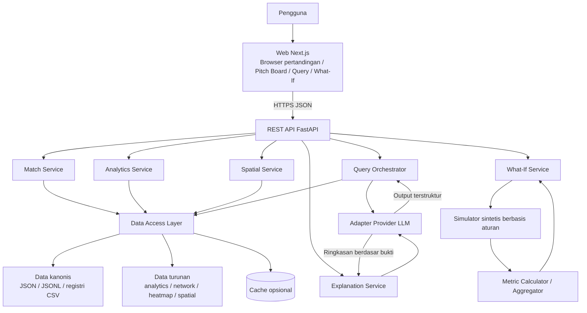
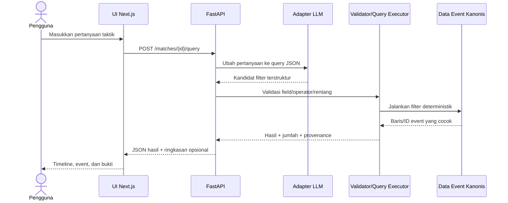
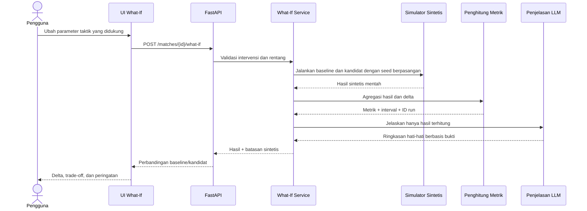
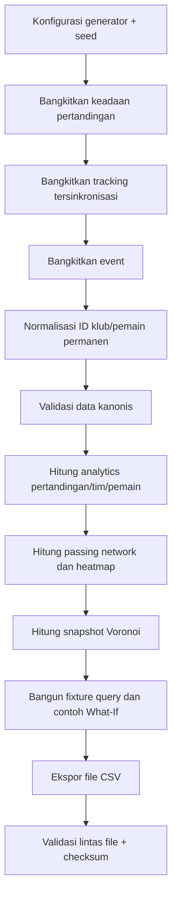

# TactiVision AI — Arsitektur Sistem

**Versi dokumen:** 1.0.0  
**Status:** Arsitektur yang diusulkan untuk MVP  
**Baseline data:** TactiVision Synthetic Dataset 1.1.0

## 1. Gambaran arsitektur

TactiVision AI dipisahkan menjadi lapisan presentasi web, API/aplikasi Python, layanan analitik dan simulasi deterministik, lapisan akses data, serta adapter provider LLM opsional. Batas terpentingnya: layanan deterministik bertanggung jawab atas filter event dan kalkulasi numerik; LLM hanya menafsirkan bahasa dan menjelaskan hasil yang sudah dihitung.



## 2. Stack implementasi yang direkomendasikan

| Lapisan | Teknologi yang disarankan | Tanggung jawab |
|---|---|---|
| Frontend web | Next.js App Router + TypeScript | Routing, halaman, state UI, panggilan API |
| Styling/komponen | Tailwind CSS dan komponen yang aksesibel | Layout responsif dan kontrol konsisten |
| Renderer lapangan | SVG atau Canvas; mulai dari SVG untuk objek yang mudah diperiksa | Marker pemain, garis operan, heatmap, poligon Voronoi |
| Backend API | Python + FastAPI + Pydantic | REST endpoint, validasi request, orkestrasi service |
| Analitik tabular | Python; NumPy/Pandas bila diperlukan | Agregasi, filter, metrik turunan |
| Kalkulasi spasial | SciPy/Shapely atau alat geometri setara yang teruji | Voronoi dan clipping ke batas lapangan |
| Penyimpanan data MVP | File JSON/JSONL dan CSV berversi | Data sumber pertandingan sintetis dan artefak turunan |
| Penyimpanan aplikasi (nanti) | PostgreSQL | Skenario tersimpan, preferensi, metadata audit bila dibutuhkan |
| Integrasi LLM | Adapter provider; Microsoft Foundry atau provider lain yang diizinkan | Parsing bahasa alami dan penjelasan grounded |
| Pengujian | Pytest, validator schema, unit/e2e frontend | Regression test data, service, integrasi, dan UI |
| Hosting (usulan) | Azure Container Apps atau target deployment yang disetujui | Hosting web/API, konfigurasi dan secret server |

Stack ini merupakan rekomendasi, bukan klaim bahwa semua komponen sudah diimplementasikan. Untuk prototipe awal, file statis cukup; jangan menambahkan PostgreSQL/cache sebelum ada kebutuhan yang terukur.

## 3. Arsitektur data

### 3.1 Sumber kanonis dan artefak turunan

```text
data/
├── clubs.csv                       # ID klub stabil (CLUB_A ... CLUB_E)
├── player_registry.csv             # ID pemain stabil dan atribut dasar
├── fixtures.csv                    # Sepuluh pasangan home/away unik
├── dataset_manifest.json           # Versi dan jumlah data
├── event_type_dictionary.csv
├── metric_dictionary.csv
├── query_examples.jsonl
├── what_if_scenarios.jsonl         # Contoh skenario global
├── what_if_runs.jsonl              # Contoh hasil run global
├── matches/{match_id}/
│   ├── match.json                  # Metadata, dua klub, pemain, taktik
│   ├── events.jsonl                # Event kanonis
│   ├── tracking.jsonl              # Snapshot tersinkronisasi 22 pemain + bola
│   ├── analytics.json              # Metrik tim/pemain dan jendela waktu
│   ├── passing_network.json        # Graf passer/receiver turunan
│   ├── heatmaps.json               # Grid densitas spasial turunan
│   ├── spatial_analytics.json      # Snapshot Voronoi yang sudah dihitung
│   ├── what_if_scenarios.jsonl
│   ├── what_if_runs.jsonl
│   ├── query_examples.jsonl
│   └── match_summary.json
└── flat/                            # Ekspor CSV praktis
```

**Kebijakan sumber kebenaran:** event dan tracking menjadi input kanonis untuk analitik event/spasial. `analytics.json`, passing network, heatmap, Voronoi, summary, dan `flat/*.csv` adalah artefak turunan. Jika data kanonis berubah, jalankan ulang pipeline derivasi/ekspor dan validator; jangan memperbaiki file turunan secara manual.

### 3.2 Konvensi koordinat dan waktu

- Ukuran lapangan: 105 × 68 meter.
- Koordinat adalah meter absolut; x mengikuti panjang lapangan dan y mengikuti lebar, sesuai konvensi yang dicatat pada setiap pertandingan.
- Waktu pertandingan berjalan dari 0 sampai 5.400 detik, tidak termasuk jeda paruh waktu; waktu lokal babak dimulai ulang pada babak kedua.
- Snapshot tracking dibuat setiap lima detik dan mencakup 22 pemain serta bola.
- Data Voronoi yang sudah dihitung tersedia pada interval satu menit. Timestamp lain harus dihitung dari snapshot tracking tersinkronisasi atau ditolak dengan pesan yang jelas.

### 3.3 Pola akses data

- Muat satu pertandingan per permintaan; jangan memuat seluruh CSV tracking gabungan untuk setiap request.
- Gunakan `analytics.json`, `passing_network.json`, `heatmaps.json`, dan `spatial_analytics.json` yang sudah dihitung untuk tampilan umum.
- Baca/stream `events.jsonl` kanonis untuk filter dan jejak audit.
- Baca snapshot terkait dari `tracking.jsonl` untuk timestamp terpilih; untuk produksi, pertimbangkan indeks timestamp per pertandingan atau format penyimpanan terindeks yang ringan.
- Perlakukan CSV di `flat/` sebagai ekspor untuk eksplorasi/SQL/BI, bukan jalur tulis runtime utama.

## 4. Tanggung jawab komponen

### 4.1 Frontend web

- Daftar pertandingan dan halaman detail pertandingan.
- Pitch board: filter tim, pemilih waktu, marker pemain/event, passing edges, layer heatmap/Voronoi.
- Form query bahasa alami, tabel hasil, timeline event, dan panel bukti.
- Kontrol What-If hanya untuk parameter yang diizinkan; tampilkan perbandingan baseline/kandidat dan batasan.
- Tampilkan provenance dan status loading, hasil kosong, input tidak valid, serta error provider.

UI tidak menghitung metrik otoritatif dari data mentah secara sewenang-wenang dan tidak meminta LLM menentukan hasil numerik. UI meminta data dari API lalu menampilkannya.

### 4.2 Lapisan API FastAPI

- Validasi path/query/body menggunakan model Pydantic.
- Resolusi `match_id`, `team_id`, `player_id`, timestamp yang didukung, dan intervensi yang diizinkan.
- Memanggil domain service dan mengembalikan objek JSON berversi.
- Menerapkan batas ukuran request, timeout, rate limit untuk endpoint LLM, correlation ID, dan error yang aman.

### 4.3 Match/data service

- Membaca data kanonis dan registri.
- Memeriksa ID sumber daya dan relasinya.
- Menyediakan akses per pertandingan, bukan scan seluruh file untuk setiap request.
- Melakukan cache metadata kecil dan analytics precomputed bila profiling menunjukkan manfaat.

### 4.4 Analytics service

- **Passing network:** kelompokkan event operan berdasarkan passer/receiver dan hitung attempts/completions.
- **Heatmap:** sajikan grid precomputed atau hitung grid baru dari titik kanonis bila filter yang dipilih didukung.
- **Statistik pertandingan dan jendela waktu:** sajikan metrik precomputed dan uji secara independen terhadap event kanonis.
- Setiap metrik perlu menunjukkan definisi/satuan atau merujuk ke metric dictionary.

### 4.5 Spatial service

- Pilih timestamp tracking dengan 22 pemain.
- Hitung wilayah Voronoi dari posisi pemain dan potong poligon ke batas lapangan.
- Kembalikan sel, luas, identitas pemain/tim, timestamp, dan metode.
- Nyatakan bahwa Voronoi nearest-player adalah aproksimasi geometris, bukan model penuh tekanan, kontrol, atau penguasaan bola.

### 4.6 Natural-language query orchestrator

Alur query sengaja memisahkan parser dan executor:

1. Terima pertanyaan beserta konteks pertandingan/tim/waktu opsional.
2. Minta LLM terkonfigurasi (atau fallback deterministik terbatas) menghasilkan JSON sesuai schema query.
3. Validasi JSON dengan allowlist field/operator; tolak event type yang tak dikenal, rentang invalid, atau filter tak disetujui.
4. Jalankan query dengan kode Python/database terhadap event kanonis.
5. Kembalikan jumlah hasil, ID event, field yang diperlukan untuk visualisasi, dan metadata pemotongan hasil bila ada.
6. Jika diperlukan, kirim hasil tersebut ke explanation service untuk ringkasan bahasa alami.

LLM tidak boleh menjalankan SQL/Python, membuat baris event, menentukan sendiri jumlah hasil, atau mengarang bukti yang hilang.

### 4.7 What-If service dan simulator

- Menerima konfigurasi awal dan satu intervensi yang didukung. MVP awal dapat dimulai dengan intensitas pressing dan tinggi garis pertahanan; parameter tambahan hanya setelah diuji.
- Memvalidasi rentang parameter dan membentuk konfigurasi kandidat.
- Mengevaluasi baseline dan kandidat menggunakan seed/repetisi berpasangan sehingga randomness terkendali sejauh kemampuan simulator.
- Menghitung delta metrik, ringkasan ketidakpastian, metadata simulasi, dan batasan.
- Mengembalikan status interpretasi eksplisit seperti `simulated_estimate`.
- Menolak intervensi yang tidak didukung alih-alih memberikan narasi seolah simulasi sudah dijalankan.

Skenario/run yang disertakan dalam dataset adalah contoh hasil. Sandbox interaktif harus benar-benar menjalankan intervensi yang didukung di runtime engine, atau dengan jelas membatasi UI pada pemutaran ulang skenario precomputed. Menggeser ikon di browser saja bukan simulasi yang sah.

### 4.8 Adapter provider LLM

Gunakan antarmuka kecil agar API tidak terikat ke satu provider. Adapter memiliki metode terpisah untuk parsing query dan penjelasan berbasis bukti, menerapkan timeout/batas token, memvalidasi output terstruktur, mencatat versi provider/model dengan aman, serta tidak pernah mencatat secret. Microsoft Foundry dapat digunakan jika cocok dengan setup hackathon; arsitektur produk sebaiknya tidak bergantung pada format respons provider di luar adapter.

## 5. Usulan REST API

Prefix: `/api/v1`. Endpoint berikut merupakan kontrak awal yang diusulkan; **belum diimplementasikan** pada paket dataset saat ini.

| Metode dan endpoint | Tujuan | Input utama | Output utama |
|---|---|---|---|
| `GET /matches` | Daftar fixture | `team_id` opsional | ID pertandingan, klub, metadata ringkasan/skor |
| `GET /matches/{match_id}` | Metadata pertandingan | ID pertandingan | Klub, pemain, formasi, lapangan, aturan waktu |
| `GET /matches/{match_id}/analytics` | Statistik ringkasan | Filter tim/waktu opsional | Statistik tim/pemain, key moments, jendela waktu |
| `GET /matches/{match_id}/events` | Browser event | Tim, event type, rentang, limit/cursor | Event dan metadata pagination |
| `GET /matches/{match_id}/passing-network` | Tampilan network | `team_id`, rentang waktu | Node, edge, metrik attempts/completions |
| `GET /matches/{match_id}/heatmap` | Lapisan heatmap | Tim, surface, periode/waktu/filter | Grid, dimensi, skala/legenda |
| `GET /matches/{match_id}/voronoi` | Wilayah spasial | `elapsed_sec` | Sel, luas, metode, timestamp |
| `POST /matches/{match_id}/query` | Filter bahasa alami | Pertanyaan, bahasa, konteks tim/waktu opsional | Query tervalidasi, jumlah hasil, event/ID, status penjelasan |
| `POST /matches/{match_id}/what-if` | Jalankan intervensi taktik | Tim, konfigurasi awal, intervensi, repetisi/seed | Metrik baseline/kandidat, delta, interval, catatan batasan |
| `GET /health` | Kesehatan layanan | Tidak ada | Status dan versi, tanpa secret |

### Aturan kontrak API

- Semua waktu berupa detik elapsed pertandingan kecuali field menyatakan lain.
- ID menggunakan `CLUB_A..CLUB_E`, ID pemain stabil, dan ID pertandingan `SYN_001..SYN_010`.
- Response sebaiknya mencakup `match_id` dan trace/correlation ID jika sesuai.
- Gunakan `400` untuk schema/range error, `404` untuk match/team/player yang tidak dikenal, `422` untuk operasi tak didukung, dan `503` untuk provider model yang tidak tersedia; gunakan format error JSON yang aman dan konsisten.
- Pertimbangkan pagination untuk event dan batas maksimum jumlah event ID dalam respons.

## 6. Alur interaksi

### 6.1 Query taktik bahasa alami



### 6.2 Intervensi What-If



## 7. Pipeline pemrosesan data offline



Jika data kanonis berubah, bangun ulang seluruh derivatif yang terdampak. Ekspor `flat/` perlu dibuat ulang setelah sumber kanonis berubah; jangan hanya mengedit CSV sebagai satu-satunya perbaikan.

## 8. Batas validasi dan penanganan error

- Validasi semua body request dan objek query yang dihasilkan LLM.
- Tolak field/operator yang tidak dikenal, waktu di luar rentang, serta koordinat di luar batas lapangan kecuali kontrak mengizinkannya.
- Jika timestamp Voronoi tidak tersedia, hitung dari snapshot tersinkronisasi yang dipilih (dan kembalikan timestamp aktual dengan jelas) atau kembalikan error validasi. Jangan memberi kesan bahwa posisi persis tersedia pada waktu yang tidak teramati.
- Jika provider LLM gagal, pertahankan filter deterministik dan tawarkan error yang jelas atau filter manual.
- Jika intervensi tidak termasuk allowlist simulator, kembalikan `422 unsupported_intervention`.
- Sertakan versi dataset, versi simulator, seed, dan metode kalkulasi dalam respons terkait untuk reproduksibilitas.

## 9. Keamanan dan privasi

- Simpan kredensial provider hanya pada environment server atau secret manager.
- Jangan mengirim API key LLM ke bundle browser.
- Terapkan rate limit dan timeout pada endpoint generatif.
- Perlakukan teks pengguna sebagai input tidak tepercaya; hanya filter terstruktur tervalidasi yang boleh masuk ke query executor.
- Jangan mengizinkan path pengguna, perintah shell, Python, atau SQL melalui lapisan query.
- Dataset saat ini berisi identitas fiktif, tetapi hindari tetap mencatat prompt pengguna atau secret yang tidak diperlukan.

## 10. Topologi deployment

### Pengembangan lokal

- `apps/web`: server development Next.js.
- `services/api`: FastAPI/Uvicorn.
- `data/`: file sintetis bersama yang hanya dibaca oleh aplikasi.
- Environment variable mengatur base URL API dan provider LLM; `.env` harus diabaikan Git.

### Demo hosted awal

- Deploy web dan API sebagai layanan terpisah (misalnya Azure Static Web Apps/Container Apps bergantung mode frontend, dan Azure Container Apps untuk FastAPI).
- Jadikan dataset artefak immutable berversi atau masukkan ke image API untuk demo kecil.
- Kelola kredensial provider dengan managed secret, aktifkan log request tanpa secret, dan pin versi dataset/simulator.
- Tambahkan database, object storage, atau cache terdistribusi hanya jika skenario pengguna tersimpan atau skala yang terukur memang membutuhkannya.

## 11. Strategi pengujian

- **Uji kontrak data:** jalankan validator schema dan konsistensi lintas file.
- **Unit test:** validasi query parser, eksekusi filter, kalkulasi metrik, transformasi koordinat, clipping Voronoi, rentang parameter.
- **Golden test:** fixture `query_examples.jsonl` dan jumlah/ID event yang diharapkan; bandingkan analytics dengan event.
- **Uji simulasi:** intervensi yang tidak didukung ditolak, reproduksibilitas seed, identitas delta kandidat-baseline, rekonsiliasi agregasi run.
- **Uji API:** sukses, input malformed, ID tidak dikenal, hasil kosong, LLM outage, timeout, dan rate limit.
- **Uji UI:** pemilihan pertandingan, filter tim/waktu, layer pitch, submit query, perbandingan What-If, peringatan sintetis.
- **Uji performa:** ukur latensi query event, summary, snapshot spasial, dan What-If; lakukan optimasi berdasarkan hasil profil.

## 12. Keputusan arsitektur

1. **Mulai dengan data statis kanonis:** volume prototipe/hackathon saat ini belum membutuhkan database.
2. **Simpan artefak derivatif untuk visual umum:** menghindari perhitungan heatmap/network setiap halaman dibuka.
3. **Gunakan query executor deterministik:** interpretasi LLM bukanlah eksekusi query data.
4. **Simulasi sintetis dengan seed berpasangan:** mendukung perbandingan terkontrol, tanpa klaim validitas kausal dunia nyata.
5. **Gunakan adapter provider:** mengisolasi format API vendor LLM dan mendukung fallback/pengujian.
6. **Jaga provenance eksplisit:** setiap visual/klaim harus dapat ditelusuri ke pertandingan, waktu, versi dataset, atau ID run.
